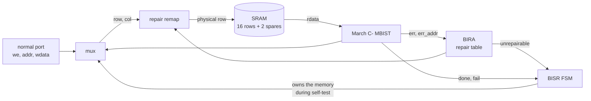

# SRAM Built-In Self-Repair (MBIST + 2D Redundancy Analysis + Row/Column Repair)

[](https://github.com/ymt1001816-cyber/sram-bisr/actions/workflows/ci.yml)
[](https://github.com/ymt1001816-cyber/sram-bisr/actions/workflows/openroad.yml)

An SRAM that tests and repairs itself: a programmable memory BIST finds faulty cells, built-in redundancy analysis
decides which rows to replace, the address path remaps those rows to spare rows, and a second March run checks the repair.
This is the soft-repair flow that production memories use to recover yield.

The BIST runs any of four March algorithms from a small table, and a fault-injection experiment measures what each one
catches: **March C- misses read- and write-disturb faults (0% and 51%) that March SS catches, at 2.2× the test time.**

A second version adds spare bit-columns and 2D redundancy analysis: **with the same four spare lines, 2 rows + 2 columns
repair 99.8% of memories with line faults, against 66% with rows only.**

Meiyu Kuo · personal project, 2026

## How it works



`bist_start` runs:

1. **Test 1:** the selected March algorithm (`alg`, default March C-) over the logical address space, remap off. Every wrong read reports its row to BIRA.
2. **Analysis (BIRA):** a table of `{valid, row}` entries, one per spare. A row already in the table is ignored (a bad row
   fails many reads), a new row takes the first free entry, and a new row with no free entry marks the memory unrepairable.
3. **Repair:** the remap logic sends every access to a recorded row to its spare row instead.
4. **Test 2:** the same algorithm again, through the remap. This checks the spare rows themselves and the remap logic.

`bist_status` reports **PASS** (no fault), **REPAIRED** (faults found and fixed) or **FAIL** (more bad rows than spares,
or test 2 fails). The SRAM is 16 rows × 4 words × 8 bits with 2 spare rows; all sizes are parameters.

## Programmable MBIST and March algorithm comparison

`rtl/mbist_prog.v` stores each algorithm as a list of march elements, `{direction, number of operations, up to 5
operations}`, and one sequencer runs whichever list `alg` selects:

| `alg` | Algorithm | Length | Elements |
|---|---|---|---|
| 0 | MATS+ | 5N | ⇕(w0) ⇑(r0,w1) ⇓(r1,w0) |
| 1 | March X | 6N | ⇕(w0) ⇑(r0,w1) ⇓(r1,w0) ⇕(r0) |
| 2 | March C- | 10N | ⇕(w0) ⇑(r0,w1) ⇑(r1,w0) ⇓(r0,w1) ⇓(r1,w0) ⇕(r0) |
| 3 | March SS | 22N | ⇕(w0) ⇑(r0,r0,w0,r0,w1) ⇑(r1,r1,w1,r1,w0) ⇓(r0,r0,w0,r0,w1) ⇓(r1,r1,w1,r1,w0) ⇕(r0) |

**Fault coverage** (`tb/test_march_cov.py`): for each fault type, 100 random instances are injected one at a time
(random cell, random aggressor word, random power-up contents, coupling sensitized by a rising or falling write),
and every algorithm runs on the same instances:

| Fault | MATS+ (5N) | March X (6N) | March C- (10N) | March SS (22N) |
|---|---:|---:|---:|---:|
| stuck-at-0 | 100% | 100% | 100% | 100% |
| stuck-at-1 | 100% | 100% | 100% | 100% |
| transition 0→1 | 100% | 100% | 100% | 100% |
| transition 1→0 | 42% | 100% | 100% | 100% |
| inversion coupling (CFin) | 74% | 100% | 100% | 100% |
| idempotent coupling (CFid) | 30% | 48% | 100% | 100% |
| state coupling (CFst) | 48% | 48% | 100% | 100% |
| address decoder (AF) | 100% | 100% | 100% | 100% |
| read destructive (RDF) | 100% | 100% | 100% | 100% |
| deceptive read destructive (DRDF) | 0% | 0% | 0% | 100% |
| write destructive (WDF) | 51% | 51% | 51% | 100% |

- MATS+ ends with w0 and never reads it back, so a cell that cannot fall to 0 is caught only when it powered up at 0.
- March C- reads each cell once per element: a deceptive read-destructive fault returns the right value, flips the
  cell, and is never seen. March SS reads twice in a row (r0, r0) and catches it on the second read.
- March C- never writes a value a cell already holds, so a write-destructive fault is caught only by chance (when the
  first w0 lands on a cell that powered up at 0). March SS does r0, w0, r0.

**Equivalence:** `formal/equiv.sby` proves that the programmable engine running March C- matches the original hand-written
controller (`rtl/mbist_march.v`, from my cache project) cycle by cycle, for any memory read data: bounded over two
complete runs, and unbounded by k-induction for an 8-word memory (the logic is identical for any size; at 64 words the
induction depth would have to exceed one march element). A wrong direction, swapped operations or a missing element
all fail the check.

## Spare columns and 2D redundancy analysis

Spare rows cannot fix a broken bit line (the column-fault test above fails). `rtl/sram_bisr2d.v` adds 2 spare bit-columns
next to the 2 spare rows; a replaced bit of a word is written to and read from its spare column instead of the array.

**Which allocator?** Choosing rows and columns to cover a fault map is NP-complete in general, so `analysis/` compares
allocators in Python first (16 rows × 32 bit-columns, 2000 random fault maps per point; the exhaustive allocator is
checked against brute force):

| Faults | Rows only (4 spare rows) | Greedy (2 + 2) | Must-repair + greedy (2 + 2) | Exhaustive optimum (2 + 2) |
|---:|---:|---:|---:|---:|
| 5 random cells | 49.6% | 63.9% | 63.9% | 63.9% |
| 6 random cells | 19.9% | 31.3% | 31.3% | 31.6% |
| 4, 20% of them whole broken lines | 66.2% | 99.8% | 99.8% | 99.8% |
| 5, 20% of them whole broken lines | 29.6% | 55.5% | 55.5% | 55.5% |

Columns pay off most when whole lines fail, and greedy stays within 0.4% of the optimum, so the hardware
(`rtl/bira2d.v`) uses it:

1. **During test 1:** each wrong read reports its failing bits; the lowest bit not yet covered is the new fault. If its
   row now has more faults than the spare columns left can fix, the row must take a spare row right away (and the same
   for columns). Otherwise the fault goes into an 8-entry table.
2. **After test 1:** one line per cycle, the row or column with the most faults left in the table, until the table is
   empty (then test 2 runs through the row and column repair) or no spare fits (FAIL).

`tb/test_bisr2d.py` checks broken bit lines, a row that must take a spare row, a faulty spare column, and random maps of
2 to 8 faults against the Python models: whenever no 2 + 2 repair exists the hardware must report FAIL, every REPAIRED
memory must pass random reads and writes, and the hardware repaired exactly the maps the greedy and exhaustive models
repair (84 of 150). Must-repair in the analysis phase turned out to change nothing (greedy picks the same line), so it
was removed from the hardware.

## Verification

**Simulation** (`tb/test_bisr.py`, cocotb + Icarus Verilog). The memory model (`model/sram_array.v`) takes injected faults.
Each test checks the status and the number of spare rows used. After PASS or REPAIRED it also runs 600 random writes and
reads through the normal port against a reference model.

| Injected faults | Expected | Why it matters |
|---|---|---|
| none | PASS, 0 spares | no false repairs |
| one stuck-at-0 cell | REPAIRED, 1 spare | basic repair |
| stuck-at-1 and transition faults in two rows | REPAIRED, 2 spares | all spares used |
| three faults in one row | REPAIRED, **1** spare | BIRA does not waste spares on a row it already has |
| three faulty rows | FAIL | more bad rows than spares |
| coupling: a write to row 3 flips a cell in row 10 | REPAIRED, 1 spare | the victim row is replaced |
| row 4 faulty **and the spare that replaces it** | FAIL | only the retest (test 2) catches it |
| a broken bit line (one bit of one column, every row) | FAIL | spare rows cannot repair a column fault |
| random 0–4 cell faults, 20 rounds | by number of faulty rows | |

The testbench catches planted RTL bugs: no duplicate check in BIRA, no retest after repair, and swapped spare indices.

**Formal** (`formal/`, SymbiYosys). The repair logic (BIRA + remap) is proven with k-induction (unbounded), with every
input free: errors on any row in any cycle, clear at any time, any two rows looked up at once.

- The table never stores a row twice, fills from entry 0 up, and is marked unrepairable only when full.
- **The remap is one-to-one:** two different rows never reach the same physical row, so a repair cannot alias data.
- A spare row is used only for the row stored in its valid entry; every other row maps to itself.
- Every recorded error ends up repaired or marks the memory unrepairable.
- Proven for 2, 3 and 4 spares. Mutated RTL (no duplicate check, wrong entry chosen, wrong spare index, valid bit ignored)
  fails the proof. Cover statements show that a full table, an unrepairable memory and a remap to spare 1 are reachable.

## Area (OpenROAD)

`.github/workflows/openroad.yml` takes the design through OpenROAD (nangate45, 200 MHz) with the hierarchy kept, to show
what the self-repair logic costs next to the memory. The memory is a flip-flop stand-in (`openroad/sram_array_ff.v`):
a real SRAM bit cell is several times smaller than a flip-flop, so the overhead seen here would be larger next to a
compiled SRAM macro of this size, and smaller for a realistic memory of many kilobits, where the repair logic grows only
with the number of spares and address bits.

Cell area by module (nangate45, synthesis, `openroad/area_by_module.sh`):

| Block | Area (µm²) | Share |
|---|---:|---:|
| Memory array (16 rows + 2 spare rows, flip-flops) | 4,438 | 90.2% |
| Programmable March MBIST (4 algorithms) | 245 | 5.0% |
| BIRA repair table | 106 | 2.1% |
| Row remap | 27 | 0.5% |
| BISR state machine and port mux | 107 | 2.2% |
| **Total** | **4,922** | |

The self-test and repair logic is **9.8%** of the total here, and the two spare rows add another 2/18 of the array
(about 500 µm²). After place and route: 5,739 µm² of cells, setup met at 200 MHz (worst slack 3.16 ns), 0 routing DRC
violations, and the layout netlist passes the equivalence check. Making the MBIST programmable cost 75 µm² over the
fixed March C- controller (170 → 245 µm²), about 1.5% of the design.

## Run it

Needs [OSS CAD Suite](https://github.com/YosysHQ/oss-cad-suite-build) (Verilator, Icarus Verilog, cocotb, Yosys, SymbiYosys).

```bash
ci/regress.sh all                 # lint, simulation, March coverage, 2D repair, formal: 13 checks
cd tb && make -f Makefile.2d       # 2D repair tests  (ROUNDS=random fault maps)
cd analysis && python3 monte_carlo.py   # allocator comparison table
cd tb && make                     # repair tests  (ALG=0..3, ROUNDS=random rounds, COCOTB_RANDOM_SEED=n)
cd tb && make -f Makefile.cov SAMPLES=100   # March algorithm coverage table (CI uses 40 per fault type)
cd formal && sby -f repair.sby prove
```

The same checks run in GitHub Actions on every push.

## Files

| Path | Contents |
|---|---|
| `rtl/sram_bisr.v` | top: BISR state machine, memory port mux |
| `rtl/mbist_prog.v` | programmable March BIST: MATS+, March X, March C-, March SS |
| `rtl/mbist_march.v` | the original March C- controller (from my [cache project](https://github.com/ymt1001816-cyber/cache-rtl-to-signoff)), the reference for the equivalence check |
| `rtl/bira.v` | built-in redundancy analysis: the repair table |
| `rtl/repair_remap.v` | logical row → physical row |
| `rtl/sram_bisr2d.v`, `rtl/bira2d.v` | 2D version: spare rows + spare bit-columns, on-the-fly must-repair and greedy allocation |
| `analysis/` | Python allocators (rows only, greedy, must-repair + greedy, exhaustive), Monte Carlo, tests |
| `model/sram_array.v` | behavioral SRAM with spare rows and 12 injectable fault types (stuck-at, transition, coupling, decoder, read / write disturb, column) |
| `tb/` | cocotb repair tests (`test_bisr.py`, 2D: `test_bisr2d.py`), March coverage experiment (`test_march_cov.py`) |
| `formal/` | repair-logic proof (`repair.sby`), MBIST equivalence check (`equiv.sby`) |
| `openroad/` | OpenROAD config, constraints, flip-flop memory stand-in |
| `ci/regress.sh` | regression script used by CI |

## Limitations

- The 2D version records at most one new faulty bit per read and keeps 8 table entries; a March reads every word
  several times, and anything missed makes test 2 fail (FAIL, never a false REPAIRED). Its area is not yet measured
  in the OpenROAD flow, which runs the row-only version.
- Soft repair: the repair table is rebuilt by every self-test (for example at power-up) instead of being burned into eFuses.
- Unused spare rows are not tested before they are needed; test 2 covers every spare that is actually used.
- The SRAM is a behavioral model with combinational read, not a compiled macro.

## Related

- [1 KB Cache: RTL to Signoff](https://github.com/ymt1001816-cyber/cache-rtl-to-signoff): cache taken from RTL to a signed-off 45 nm layout, where the March C- MBIST first appeared
- [Async FIFO: a CDC bug that simulation cannot see](https://github.com/ymt1001816-cyber/async-fifo-cdc)

RTL written by Meiyu Kuo. Testbench, memory model, formal harness and documentation were developed with AI assistance (Claude).
