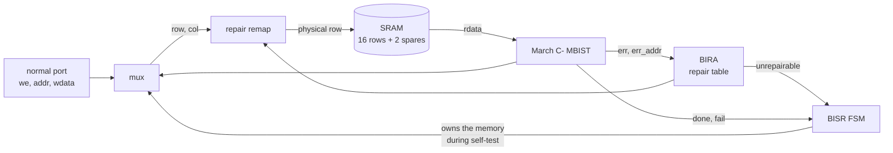

# SRAM Built-In Self-Repair (MBIST + BIRA + Row Repair)

[](https://github.com/ymt1001816-cyber/sram-bisr/actions/workflows/ci.yml)
[](https://github.com/ymt1001816-cyber/sram-bisr/actions/workflows/openroad.yml)

An SRAM that tests and repairs itself: a March C- memory BIST finds faulty cells, built-in redundancy analysis decides
which rows to replace, the address path remaps those rows to spare rows, and a second March run checks the repair.
This is the soft-repair flow that production memories use to recover yield.

Meiyu Kuo · personal project, 2026

## How it works



`bist_start` runs:

1. **Test 1:** March C- (10N operations) over the logical address space, remap off. Every wrong read reports its row to BIRA.
2. **Analysis (BIRA):** a table of `{valid, row}` entries, one per spare. A row already in the table is ignored (a bad row
   fails many reads), a new row takes the first free entry, and a new row with no free entry marks the memory unrepairable.
3. **Repair:** the remap logic sends every access to a recorded row to its spare row instead.
4. **Test 2:** March C- again, through the remap. This checks the spare rows themselves and the remap logic.

`bist_status` reports **PASS** (no fault), **REPAIRED** (faults found and fixed) or **FAIL** (more bad rows than spares,
or test 2 fails). The SRAM is 16 rows × 4 words × 8 bits with 2 spare rows; all sizes are parameters.

## Verification

**Simulation** (`tb/test_bisr.py`, cocotb + Icarus Verilog). The memory model (`model/sram_array.v`) takes injected faults.
Each test checks the status and the number of spare rows used. After PASS or REPAIRED it also runs 600 random writes and
reads through the normal port against a reference model.

| Injected faults | Expected | Why it matters |
|---|---|---|
| none | PASS, 0 spares | no false repairs |
| one stuck-at-0 cell | REPAIRED, 1 spare | basic repair |
| stuck-at-1 and transition faults in two rows | REPAIRED, 2 spares | all spares used |
| three faults in one row | REPAIRED, **1** spare | BIRA does not waste spares on a row it already has |
| three faulty rows | FAIL | more bad rows than spares |
| coupling: a write to row 3 flips a cell in row 10 | REPAIRED, 1 spare | the victim row is replaced |
| row 4 faulty **and the spare that replaces it** | FAIL | only the retest (test 2) catches it |
| a broken bit line (one bit of one column, every row) | FAIL | spare rows cannot repair a column fault |
| random 0–4 cell faults, 20 rounds | by number of faulty rows | |

The testbench catches planted RTL bugs: no duplicate check in BIRA, no retest after repair, and swapped spare indices.

**Formal** (`formal/`, SymbiYosys). The repair logic (BIRA + remap) is proven with k-induction (unbounded), with every
input free: errors on any row in any cycle, clear at any time, any two rows looked up at once.

- The table never stores a row twice, fills from entry 0 up, and is marked unrepairable only when full.
- **The remap is one-to-one:** two different rows never reach the same physical row, so a repair cannot alias data.
- A spare row is used only for the row stored in its valid entry; every other row maps to itself.
- Every recorded error ends up repaired or marks the memory unrepairable.
- Proven for 2, 3 and 4 spares. Mutated RTL (no duplicate check, wrong entry chosen, wrong spare index, valid bit ignored)
  fails the proof. Cover statements show that a full table, an unrepairable memory and a remap to spare 1 are reachable.

## Area (OpenROAD)

`.github/workflows/openroad.yml` takes the design through OpenROAD (nangate45, 200 MHz) with the hierarchy kept, to show
what the self-repair logic costs next to the memory. The memory is a flip-flop stand-in (`openroad/sram_array_ff.v`):
a real SRAM bit cell is several times smaller than a flip-flop, so the overhead seen here would be larger next to a
compiled SRAM macro of this size, and smaller for a realistic memory of many kilobits, where the repair logic grows only
with the number of spares and address bits.

## Run it

Needs [OSS CAD Suite](https://github.com/YosysHQ/oss-cad-suite-build) (Verilator, Icarus Verilog, cocotb, Yosys, SymbiYosys).

```bash
ci/regress.sh all                 # lint, simulation (3 seeds x 9 tests), formal: 6 checks
cd tb && make                     # simulation only  (ROUNDS=random rounds, COCOTB_RANDOM_SEED=n)
cd formal && sby -f repair.sby prove
```

The same checks run in GitHub Actions on every push.

## Files

| Path | Contents |
|---|---|
| `rtl/sram_bisr.v` | top: BISR state machine, memory port mux |
| `rtl/mbist_march.v` | March C- controller (from my [cache project](https://github.com/ymt1001816-cyber/cache-rtl-to-signoff)), plus per-read error output |
| `rtl/bira.v` | built-in redundancy analysis: the repair table |
| `rtl/repair_remap.v` | logical row → physical row |
| `model/sram_array.v` | behavioral SRAM with spare rows and fault injection (stuck-at, transition, coupling, column) |
| `tb/` | cocotb testbench and Makefile |
| `formal/` | properties of the repair logic (`repair_props.sv`, `repair.sby`) |
| `openroad/` | OpenROAD config, constraints, flip-flop memory stand-in |
| `ci/regress.sh` | regression script used by CI |

## Limitations

- Row repair only. Production memories also have spare columns (for bit-line faults such as the one above), and
  allocating both kinds is NP-hard in general; with row spares only, the greedy allocation used here is optimal.
- Soft repair: the repair table is rebuilt by every self-test (for example at power-up) instead of being burned into eFuses.
- Unused spare rows are not tested before they are needed; test 2 covers every spare that is actually used.
- The SRAM is a behavioral model with combinational read, not a compiled macro.

## Related

- [1 KB Cache: RTL to Signoff](https://github.com/ymt1001816-cyber/cache-rtl-to-signoff): cache taken from RTL to a signed-off 45 nm layout, where the March C- MBIST first appeared
- [Async FIFO: a CDC bug that simulation cannot see](https://github.com/ymt1001816-cyber/async-fifo-cdc)

RTL written by Meiyu Kuo. Testbench, memory model, formal harness and documentation were developed with AI assistance (Claude).
